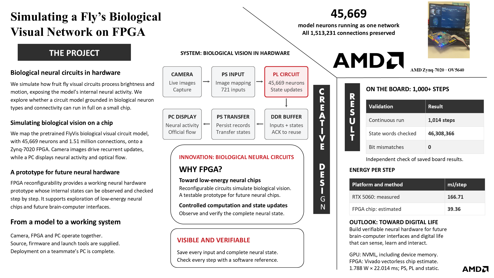

# Biological visual circuit simulation on Zynq-7020

Competition source delivery, updated 2026-11-02. Public repository access was verified on 2026-11-02. Only selected sanitized engineering exchanges are included; full private conversations remain withdrawn. Full configured FlyVis network:45,669 nodes,1,513,231 connections,721 visual inputs,strict FP32/Euler,5ms model step. PL executes the neural updates; PS handles OV5640 capture/mapping/DDR records; PC displays results and independently audits states.

## Start here

1. Read the [approved seven-page design report](report/design_report.pdf) and [English competition poster](report/poster_en_a4.pdf). The [editable poster](report/poster_en.pptx) is also included. The poster highlights hardware simulation of a biological visual circuit, with model neuron types, connectivity and recurrent state updates.
2. For the current full-FPGA camera experiment, use [board/runtime](board/runtime/README.md). On Windows x64/Python3.12 install its requirements, then run `python run.py --check-only`. For an operator-authorized board experiment use `python run.py --ip YOUR_PC_IPV4` and the newly generated fixed Notebook. This is the recommended PC entry; archived GPU/hybrid variants below are historical.
3. Review [sanitized engineering collaboration cases](report/ai_engineering_cases.md), [Skill](skill/README.md) and [build/vendor acquisition instructions](build/vendor_dependency_review.md).

The approved design-report PDF and latest English poster are synchronized with the current local materials. The report content is preserved as approved. The desktop submission archive is separately versioned; changing this repository does not update that RAR automatically.

## Current implementation

- [Current camera/PC runtime](src/flyvis-lossless-study/ov5640_live_v261_20261026/): bundle,pc,assets and tests. Includes the current chart/axis/web layout snapshot from2026-10-28 and bounded audit-monitor read fix.
- [Final Vivado2026.1 SoC](src/flyvis-lossless-study/vivado2026_1_20261026/): build scripts and release hardware metadata.
- [Original GUI and GPU integration](src/flyvis_runtime/fly/): viewer and gui_v1. Older scientific/hybrid paths are retained as historical implementations, not the current full-PL camera entry.
- [Competition skill package](skill/README.md): usage, limitations and historical verification.
- [Licensing/attribution](third_party_notices.md).

## Build and run

For the current PC entry use [board/runtime/README.md](board/runtime/README.md): Windows x64/Python3.12, install its requirements, then `python run.py --check-only`. For an operator-requested live experiment use `python run.py --ip YOUR_PC_IPV4` and the generated fixed Notebook. Board operations remain manual and require exclusive ownership; failed/unknown states are not retried automatically.

For firmware use Vivado2026.1 and [build/portable/README.md](build/portable/README.md). [Official vendor acquisition](build/vendor_dependency_review.md) documents the required reference and 56-file identity check. Fresh official-download-to-BIT reproduction and third-party redistribution permission remain unverified. Do not treat old source variants or archived scripts as the current entry.

## Evidence

Historical software/RTL/implementation reports remain in their source directories and retain their own scope. Latest full-PL camera basis:1090 steps,49,779,210 saved state words,zero mismatches in that bounded operator run. This does not establish biological equivalence,unlimited duration or200Hz realtime. Replaying saved results is offline replay. No new device experiment was run for publication.

## Export

All published paths and hashes are in public_manifest.json. Personal running notes,credentials,virtual environments,EDA caches,bulk recordings and unrelated MaleCNS/PQN projects are excluded. Original source variants are retained to preserve the engineering process; start with the current implementation above. The original competition RAR remains a separate immutable upload artifact.

## AMD guide audit

[Requirement-to-file map](report/amd_requirements.md), [seven-page design report](report/design_report.pdf), [actual implementation reports](build/), [verification summaries](sim/), [operation steps](board/reproduce.md), and [engineering AI collaboration cases](report/ai_engineering_cases.md). Repository delivery is distinct from public-release permission and fresh source-to-BIT validation; remaining boundaries are in report/amd_compliance_audit.json.

## Normalized export verification

All exported paths pass the naming check. export_path_map.json records the initial path/content transformation, while public_manifest.json records final deliverable bytes after deliberate bundle-manifest regeneration. The current46-file bundle admission and two corrupt-firmware rejection cases passed; three current JS files pass syntax checks. Four pre-existing intentionally invalid historical fixtures are recorded, not promoted to runnable Python. Historical acceptance manifests retain original candidate scope; they are not newly passed tests. Full historical functionality, browser execution and clean Vivado rebuilding remain unverified. See sim/normalized_runtime_check.json and sim/normalized_export_checks.json.

## Current deployable PC entry

Use [board/runtime](board/runtime/README.md), which assembles the current PC/web files with the existing fresh-session generator. Run `python run.py --check-only` there for the actual saved721input/full45669state CPU comparison. Then use `python run.py --ip YOUR_PC_IPV4` only when the user wants to start the receiver. Device operations remain operator-controlled. Fresh prepare-only generation was checked offline; no HTTP/browser/board experiment was run. Raw camera pixels are not public; this sample does not retest frame mapping.

## Detailed engineering and publication hold

[Detailed seven-part technical report](report/technical_report.md), [AI evidence guide](report/ai_workflow.md), [vendor dependency review](build/vendor_dependency_review.md). ALIENTEK copyrighted-source instances are identified in report/third_party_holds.json; redistributability has not been established. Publication of this reviewed inventory has been authorized by the project owner; unresolved third-party and rebuild limitations are disclosed below. The repository is public; public availability is not proof of third-party license clearance or clean-machine Vivado success.

[主要研发协作案例（脱敏）](report/ai_engineering_cases.md) · [离线阅读版](report/ai_engineering_cases.html)

## Competition directory structure

The repository follows the AMD recommended top-level layout: `src/` design sources, `sim/` verification, `build/` build scripts/reports, `board/` operation and measured outputs, `data/` saved inputs/references, `skill/` reusable workflows, and `report/` design/AI records. See [data](data/README.md) for sample scope. The existing runtime retains identical sample copies under board/runtime/checks to preserve its accepted entry.

Historical export_path_map.json and archived source manifests retain their original path labels as provenance. For a former top-level source/ path, use src/ in this layout. Directory relocation is not new acceptance of every historical implementation.

## Runtime repair — 2026-11-02

The earlier normalized export broke Python constructors despite passing syntax/reference checks. The current recommended runtime and its current source mirrors are repaired, with new display changes retained. [Actual checks](sim/runtime_repair_20261102.json) now include object construction, saved-state CPU comparison, actual isolated PC HTTP startup and official CPU flow warmup. This is not a new physical board test. Other archived versions are not current entries.

## Historical archive navigation

[Missing historical dependencies and four corrupt negative-test samples](report/archive_dependencies.md) are explicitly indexed. These are not the recommended experiment entry. Use board/runtime above; no unavailable historical attachment has been described as bundled or newly validated.

## Competition poster

[Print-ready A4 PDF](report/poster_en_a4.pdf) · [Editable PowerPoint](report/poster_en.pptx)
