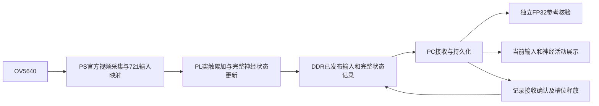

# FlyVis视觉神经网络的Zynq-7020实现：详细工程说明

本文件面向开源复现，覆盖AMD指南3.3.5.3七项内容；它是工程说明，不替代团队最终签字确认的设计报告。数字来自链接的原始报告，本次未重新执行板卡、GPU或EDA。

## 1. 背景、已有工作与本队贡献

FlyVis原作者提供连接组约束的视觉模型、预训练参数和运动视觉研究。本队没有重新训练或提出该神经网络。模型来源为Lappalainen等，Nature634,1132–1140(2024)，https://doi.org/10.1038/s41586-024-07939-3；官方项目https://github.com/TuragaLab/flyvis。

本队解决的是固定配置45,669节点、1,513,231连接、721输入在资源有限的Zynq-7020上如何完整计算、连续反馈、保存并核对。主要工程贡献为连接规则表示与有序枚举、FP32算术复用与相关性处理、PS/PL全状态传递、有限DDR环形记录、独立逐步参考审核，以及与实际活动同步的界面。模型活动不是生理电压，也不据此宣称真实果蝇行为或全脑复制。

## 2. 原理与功能框图

原始连续ReLU突触释放和Euler更新顺序保持；模型dt=0.005s。每步所有突触读取共同旧态，目标电流按冻结顺序累加，再计算节点候选；下一步读取实际更新状态。不能把不同求和顺序、FMA或预合并系数当成严格FP32逐位等价。原45,669节点均保留；GUI只读选定细胞或中心区域不表示减少计算节点。

## 3. 分工、接口与状态身份

当前完整网络路线：PL执行全部神经算术；PS负责摄像头、输入映射、控制与DDR；PC负责接收、显示和独立参考。相机映射版本为direct-grey-center-square-area/v2，不将它与历史GPU官方BoxEye路径声明为同输入逐位等价。

当前环形ABI为0x00110005，目标100MHz，器件xc7z020clg400-2。神经DDR经HP1，官方视频通路使用HP0。BIT/HWH、参数、输入、节点顺序、帧号和提交记录必须绑定。尚未确认的槽位不得被覆盖；异常或状态未知时停下并保留记录。GPU–FPGA子回路替代是保留的独立历史路线，有自己的Q24数值合同，不能与当前全网FP32结果混算。

活动展示采用保存结果或本次已接收状态。模型时间、真实采集时间、计算墙钟时间和人为回放速度各自记录。离线回放必须标识；骨架亮度与选定的真实模型读出绑定，真实SWC骨架代表类型示意，不是假称单个生物细胞的测量。

## 4. 优化与性能、资源依据

原突触表使用连接规则压缩，但必须展开为与冻结图完全相同的有序边，不能靠丢边提速。流水线复用算子并处理在途同目标相关，节点更新跨上下文交错而保持单节点运算顺序。DDR环形记录有保存和释放背压，不能用覆盖未确认结果换吞吐。

当前完整SoC实现报告：[build/result.json](../build/result.json)，原资源和时序报告同目录。Vivado2026.1、xc7z020clg400-2、布线后LUT15784、FF21124、BRAM36等效112、DSP4；指定100MHz约束下WNS+0.153ns、WHS+0.045ns。它包含相机和系统互连，不能与独立神经核的资源直接相减作为单项优化收益。

历史10/16计算SoC模拟中，无消费者停顿一步2,201,418周期，详见[sim/core_schedule.json](../sim/core_schedule.json)；当前保存运行使用不同计数边界，旧周期数不能直接当作当前整机步耗时。该报告是RTL/CPU验证，不能标作当前板测。

当前1090步运行循环60.030679911s，平均55.074018ms/步、18.157382步/s；保存49,779,210状态字零差异、相机CLOSED。证据在[board/saved_run_analysis.json](../board/saved_run_analysis.json)，仅支持该次有界操作者运行。循环不含启动、最终持久化和PC审核，不等于显示FPS或独立测量的物理时钟。

可核查的前次crop运行1093步、54.901121ms/步；当前55.074018ms/步，吞吐比0.996861。原分析明确same_stimulus_controlled=false，因此这组观测没有证明当前比前次更快，也不能把差异归因于单一改动。早期流水线资源/速度优化须按各自版本的来源报告阅读，不能将不同输入现场观测包装成受控基线比较。当前无整机板级功耗、同条件GPU能效或200Hz持续实时PASS。

## 5. AI协作与纠错

工作方式是用户确定范围和实际操作权限，AI阅读源码/报告、实现隔离候选并做软件检查，用户执行实板操作，再审核真实记录。大型模型没有替代原神经计算。历史工程协作摘要见[project_ai_excerpts.json](project_ai_excerpts.json)。本次交付任务的少量真实提示、回答与纠错记录见[ai_collaboration_record.md](ai_collaboration_record.md)，明确区分原文节选和编辑摘要；不恢复此前撤回的私人对话，不冒充完整历史记录。导航与范围见[ai_workflow.md](ai_workflow.md)。

本次开源导出也发生实际纠错：第一次把合法的新会话目录重定位误判为载荷不一致；检查现有生成器后，验证改为只允许live_board.py中的精确会话目录替换及相应manifest变化，其余载荷逐字节比对。不能为了通过检查而接受任意源码差异。来源为[sim/public_runtime_prepare.json](../sim/public_runtime_prepare.json)。

## 6. Skill提炼、验证与边界

[skill/README.md](../skill/README.md)逐项描述用途、方法、失败条件和经验来源。各项历史证据与当前任务隔离；未知路径故障仅有观察时不得提升为已复现结论。通用PYNQ加分需要换题/换板的真实复用依据；现有单板使用不自动证明通用。与MaleCNS、嗅觉PQN等其他项目有关的案例只作为经验来源，不作为本FlyVis作品结果。

## 7. 复现、验收与已知缺口

软件部署见[board/runtime/README.md](../board/runtime/README.md)：Python3.12x64安装明确依赖后，先运行`python run.py --check-only`。该命令读取已有721输入并通过独立C++程序核对全45,669状态，不接设备。当前输出差异0。源输入/初态/参考二进制和源码身份在checks/provenance.json；未公开原始相机画面，也不声称复测了映射。

运行程序会生成新的本地会话和固定Notebook；操作者准备板端，按提示执行一次。当前公开候选仅验证了prepare-only生成和载荷身份，没有启动HTTP、浏览器或新实板验收。固件重建见[build/portable/README.md](../build/portable/README.md)，文件准备已通过CPU正反例检查，尚无新的异机Vivado复建。

七页设计报告见[design_report.pdf](design_report.pdf)。厂家官方获取入口及逐项校验步骤已补充于[依赖说明](../build/vendor_dependency_review.md)。待解决：厂商再分发许可；当前官方资料下载到完整BIT的独立复建验证；完整历史功能在规范路径下的迁移验证；团队最终签字及公开发布确认。原已验收工程和RAR不被覆盖。当前目录是可审查候选，不能以文档完整替代这些未完成条件。
